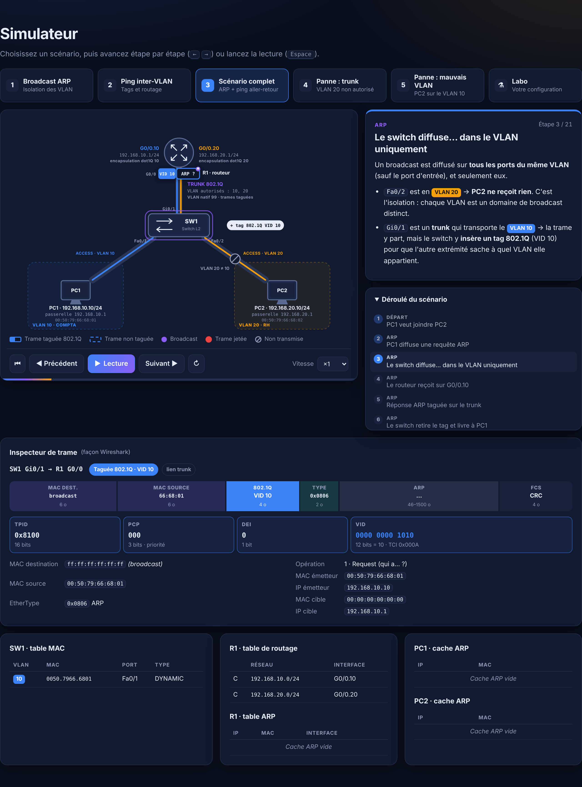

# VLAN & Trunk 802.1Q — expliqués en animation

Site pédagogique **100 % statique** (HTML, CSS, JavaScript, sans dépendance) qui montre, trame par trame, comment fonctionnent les **VLAN**, les **ports access**, le **trunk 802.1Q** et le **routage inter-VLAN** (*router-on-a-stick*).



## Topologie

```
                 R1 (router-on-a-stick)
        G0/0.10 192.168.10.1 | G0/0.20 192.168.20.1
                         │ G0/0
                         │  TRUNK 802.1Q (VLAN 10, 20 · natif 99)
                         │ Gi0/1
                 ┌───────┴───────┐
                 │      SW1      │
                 └───┬───────┬───┘
            Fa0/1    │       │    Fa0/2
     access VLAN 10  │       │  access VLAN 20
                    PC1     PC2
          192.168.10.10/24  192.168.20.10/24
```

| Équipement | Interface | VLAN | Adresse |
|---|---|---|---|
| PC1 | eth0 ↔ SW1 Fa0/1 | 10 (COMPTA) | 192.168.10.10/24, passerelle .10.1 |
| PC2 | eth0 ↔ SW1 Fa0/2 | 20 (RH) | 192.168.20.10/24, passerelle .20.1 |
| SW1 | Gi0/1 ↔ R1 G0/0 | trunk 10, 20 (natif 99) | — |
| R1 | G0/0.10 / G0/0.20 | dot1Q 10 / dot1Q 20 | 192.168.10.1 / 192.168.20.1 |

## Fonctionnalités

- **Simulateur animé** : les trames se déplacent sur la topologie, le tag 802.1Q apparaît sur le trunk et disparaît sur les ports access.
- **5 scénarios guidés** : broadcast ARP et isolation des VLAN, ping inter-VLAN, scénario complet (ARP + ping aller-retour), panne « VLAN non autorisé sur le trunk », panne « PC dans le mauvais VLAN ».
- **Inspecteur de trame** façon Wireshark : MAC, EtherType, détail du tag (TPID `0x8100`, PCP, DEI, VID en binaire), contenu ARP ou IP/ICMP, TTL.
- **États des équipements en direct** : table MAC du switch, tables ARP des PC et du routeur, table de routage.
- **Labo de dépannage** : choisissez le VLAN des ports, les VLAN autorisés sur le trunk et les sous-interfaces du routeur. La simulation est *calculée* à partir de la configuration (64 combinaisons, une seule fonctionne). Le bouton « Panne aléatoire » génère un défi.
- **Théorie** : VLAN, access ou trunk, anatomie d'une trame 802.1Q, router-on-a-stick ou switch L3, VLAN natif et bonnes pratiques.
- **Configurations prêtes à copier** : Cisco IOS (switch et routeur), PC Windows/Linux, routeur Linux équivalent, commandes de vérification.
- **Quiz** de 10 questions avec explications.
- Thème clair/sombre, responsive, navigation au clavier (`←` `→` `Espace` `Début`), respect de `prefers-reduced-motion`.

## Lancer en local

Aucune installation : ouvrez simplement `index.html` dans un navigateur.

Ou avec un petit serveur :

```bash
python3 -m http.server 8000
# puis http://localhost:8000
```

## Publier sur GitHub Pages

```bash
git init
git add .
git commit -m "Site pédagogique VLAN & trunk 802.1Q"
git branch -M main
git remote add origin https://github.com/<utilisateur>/vlan-trunk-animation.git
git push -u origin main
```

Puis, sur GitHub : **Settings → Pages → Build and deployment → Source : GitHub Actions**.
Le workflow `.github/workflows/pages.yml` publie le site à chaque push sur `main`, à l'adresse
`https://<utilisateur>.github.io/vlan-trunk-animation/`.

> Variante sans Actions : **Source : Deploy from a branch**, branche `main`, dossier `/ (root)`.

## Structure

```
.
├── index.html                 # page unique (simulateur, labo, théorie, config, quiz)
├── assets/
│   ├── css/style.css          # thèmes clair/sombre, mise en page, animations
│   ├── js/data.js             # adressage, topologie, génération des configs IOS/Linux
│   ├── js/scenario.js         # moteur : génère les étapes à partir d'une configuration
│   ├── js/app.js              # rendu SVG, animation, inspecteur, tables, labo, quiz
│   └── img/favicon.svg
├── docs/apercu.png            # capture pour ce README
├── .github/workflows/pages.yml
├── .nojekyll
└── LICENSE
```

## Personnaliser

- **Adresses, noms de VLAN, MAC** : objet `NET` dans `assets/js/data.js`.
- **Couleurs des VLAN** : variables `--v10` et `--v20` dans `assets/css/style.css`.
- **Nouveau scénario** : ajoutez une entrée au tableau `PRESETS` (fin de `assets/js/scenario.js`) avec une configuration et des options (`arp`, `arpOnly`, `reply`).
- **Questions du quiz** : tableau `QUIZ` dans `assets/js/app.js`.

Le moteur est exposé dans la console du navigateur via `window.VLANSim` (par exemple `VLANSim.buildScenario({p1:10,p2:20,allowed:[10],subs:[10,20]}, {arp:true, reply:true})`).

## Licence

[MIT](LICENSE). Les adresses MAC et IP sont fictives.
